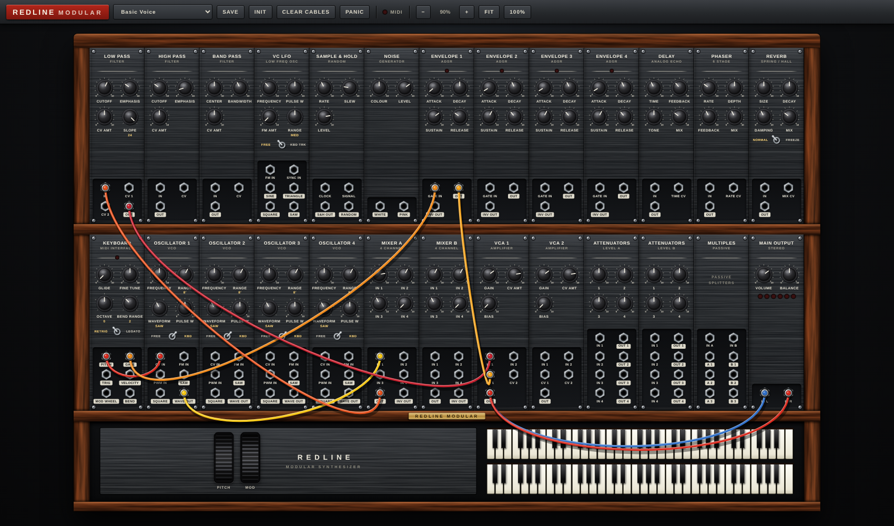
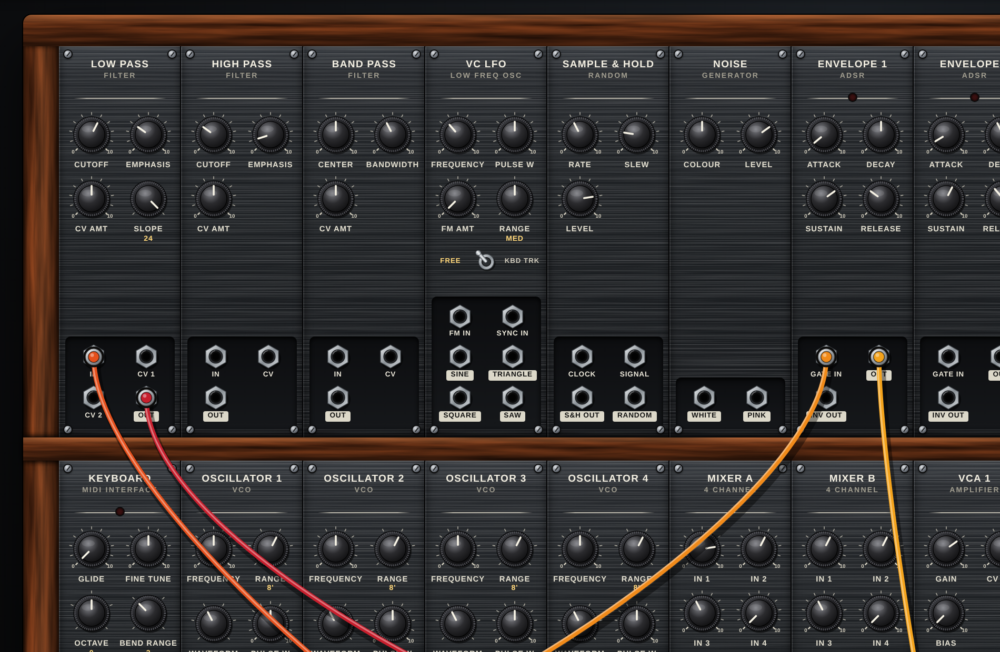

# 303moog

REDLINE MODULAR: a Moog-modular-style synth with a two-tier wooden cabinet, patch cables and an on-screen two-manual keyboard.



## UI

The interface is a single dependency-free file: [`ui/index.html`](ui/index.html). Open it in any browser to try it.

- Two-tier wooden cabinet, 26 equal-size black metal modules
- Drag knobs up/down (Shift = fine, mouse wheel, double-click resets, arrow keys when focused)
- Drag from any jack to another to patch a cable (output to input); drag a plug to move it, double-click or right-click a cable to remove it
- Full-screen with scrolling, zoom buttons, FIT, Ctrl+wheel zoom
- Starts on a clean "Basic Voice" patch; four factory presets plus SAVE for your own, and your current patch is remembered between sessions
- Pitch-bend (springs back) and mod wheels beside the keyboard
- Playable keyboard (mouse, or computer keys A W S E D F T G Y H U J K O L)



## Hooking it up to the sound engine

The page exposes `window.Redline` for the host (for example a JUCE WebView):

```js
Redline.on('param', ({id, value, text}) => {})            // knob/switch moved, value 0..1
Redline.on('cable', ({action, from, to}) => {})           // 'connect' | 'disconnect'
Redline.on('note',  ({manual, note, on, velocity}) => {}) // on-screen keyboard
Redline.on('wheel', ({id, value}) => {})              // id: bend (-1..1) | mod (0..1)
Redline.setParam('lpf.cutoff', 0.6)
Redline.connect('osc1.out', 'mixA.in1')
Redline.setLED('kbd', true); Redline.setVU(4)
Redline.getState(); Redline.setState(state)
Redline.params(); Redline.jacks()                         // every id the UI knows about
```

If `window.RedlineHost.emit(event, data)` exists, every event is forwarded to it too.

## Status

UI only for now. The knobs and cables report what they do, but no audio is generated from this repo yet.
